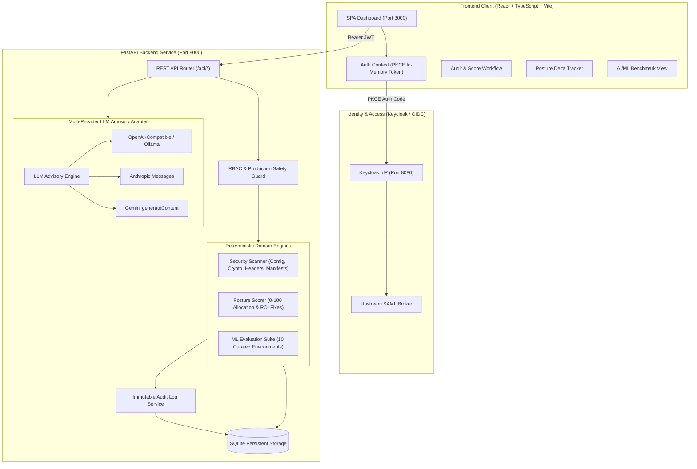

# Security Posture Scorer — Alan Vo | AI & Machine Learning

> Work in progress. This checkpoint may be incomplete or fail tests. See PLAN.md and STATUS.md before use.


Security engineering teams frequently struggle to objectively quantify, communicate, and remediate application security risks before deploying to production environments. **Security Posture Scorer** solves this problem by combining deterministic vulnerability heuristic scanning (for misconfigurations, missing HTTP response headers, weak cryptography, and vulnerable dependencies) with a calibrated 0–100 scoring model and opt-in advisory threat analysis. Intended for DevSecOps engineers, security analysts, and engineering leaders, the system deterministically audits codebases and infrastructure configs, tracks posture deltas across revisions, and prioritizes remediation fixes based on Return on Investment (ROI = impact weight / remediation effort).



---

## Core Capabilities & Workflows

1. **Multi-Vector Security Posture Auditing**:
   - **Configuration Files**: Audits JSON, YAML, TOML, `.env`, and Dockerfiles for insecure debug flags, wildcard CORS policies (`allow_origins: *`), disabled TLS transport encryption, and containers running as root.
   - **HTTP Response Headers**: Detects missing or malformed `Content-Security-Policy` (CSP), `Strict-Transport-Security` (HSTS), `X-Content-Type-Options: nosniff`, `X-Frame-Options` clickjacking defenses, and insecure cookie attributes (`HttpOnly`, `Secure`, `SameSite`).
   - **Cryptographic Algorithms & PRNGs**: Identifies broken hash algorithms (MD5, SHA-1), vulnerable ciphers and ECB mode (DES, 3DES, RC4, AES-ECB), and insecure pseudo-random number generators (`random.random()`, `Math.random()`) used for secrets or tokens.
   - **Dependency Manifests**: Audits `requirements.txt`, `package.json`, and other lockfiles against a curated vulnerability catalogue and flags unpinned package declarations.

2. **Deterministic 0–100 Scoring & ROI Fix Prioritization**:
   - 100-point score evenly distributed across four categories (25 points each): **Authentication**, **Cryptography**, **Configuration**, and **Dependencies**.
   - Categorized score deductions with clear, evidence-based descriptions.
   - Letter grades assigned deterministically: **A** (90–100), **B** (75–89), **C** (60–74), **D** (40–59), **F** (0–39).
   - Remediation fixes ranked by **Return on Investment**: $\text{ROI} = \frac{\text{Severity Weight}}{\text{Effort Cost}}$, accompanied by actionable code and configuration patches.

3. **Posture Differential Tracking & Regression Analysis**:
   - Compares any two historical scans to identify posture trends (`IMPROVED`, `REGRESSED`, `UNCHANGED`).
   - Computes score deltas, highlighting newly resolved vulnerabilities and warning against newly introduced regressions.

4. **Opt-in Grounded Threat Advisory Engine**:
   - Operator-configurable advisory threat analysis grounded strictly in deterministic scan findings.
   - Supports OpenAI-compatible endpoints, Anthropic, Gemini, and Ollama.
   - Works fully offline without credentials; provider failures fall back gracefully to local deterministic heuristic summaries without fabricating data.

---

## AI/ML Evaluation & Benchmark

The scoring model includes a reproducible evaluation engine and a curated benchmark suite comprising 10 labeled micro-environments with ground-truth vulnerability counts and calibrated score targets.

### Reproducible Benchmark Execution

To execute the benchmark suite locally:

```bash
PYTHONPATH=. .venv/bin/python backend/app/services/ml_eval.py
```

Or query the API endpoint directly:

```bash
curl -s -H "Authorization: Bearer <TOKEN>" http://127.0.0.1:8000/api/eval/benchmark | jq .
```

### Data Provenance

The 10 benchmark test environments represent realistic application setups:
- **Clean Production Baselines**: Hardened FastAPI services with strict CSP, HSTS, AES-GCM cryptography, and pinned dependencies.
- **Insecure Development Configurations**: Services with active debug flags, wildcard CORS policies, and disabled TLS.
- **Legacy Cryptographic Modules**: Codebases using MD5 hashing, DES ciphers in ECB mode, and predictable PRNGs for session tokens.
- **Web Header Vulnerabilities**: HTTP responses missing clickjacking protection and authentication cookie security attributes.
- **Supply Chain Risks**: Dependency manifests with known CVEs and unpinned package versions.

### Measured Benchmark Results

| Metric | Measured Value | Description |
|--------|----------------|-------------|
| **Evaluation Samples** | `10` | Curated ground-truth test environments |
| **Precision** | `89.19%` (`0.8919`) | True positives / (True positives + False positives) |
| **Recall** | `100.00%` (`1.0000`) | True positives / (True positives + False negatives) |
| **F1 Score** | `0.9429` | Harmonic mean of precision and recall |
| **Score MAE** | `2.90 pts` | Mean Absolute Error between predicted score and ground truth |

### Model Limitations & Failure Cases

- **Static Taint Tracking**: Heuristic scanning does not execute dynamic symbolic execution or inter-procedural data flow tracking across complex call graphs.
- **Novel Obfuscation**: Adversarial variable renaming or dynamic reflection (e.g. `getattr(hashlib, "m" + "d5")`) requires opt-in semantic LLM analysis for detection.
- **Manifest Scope**: The dependency audit inspects direct manifests; transitive vulnerability resolution requires complete lockfile analysis.

---

## Architecture & Authentication

### Authentication & Authorization (OIDC + PKCE + RBAC)

The application implements a secure SPA PKCE client architecture paired with a bearer-token FastAPI backend:
- **PKCE Flow**: Supports standard OIDC authorization code grants with SHA-256 code verifiers and challenges. Temporary code verifiers are stored in memory/sessionStorage during redirects and never persisted in `localStorage`.
- **Keycloak & SAML Brokering**: Keycloak serves as the central identity provider and brokers upstream SAML identity providers into standardized OIDC JSON Web Tokens.
- **Role-Based Access Control (RBAC)**: Enforces consistent roles across all endpoints:
  - `viewer`: Can trigger scans and view audit results and differentials.
  - `analyst`: Can additionally request LLM threat advisories and inspect audit logs.
  - `admin`: Full administrative permissions, including scan deletion.
- **Production Safety**: A dedicated startup validator (`settings.validate_production_safety()`) ensures that local demo credentials cannot be activated when `ENVIRONMENT=production`.

---

## Installation & Running

### Prerequisites

- Python 3.12+
- Node.js 24+ and npm
- Docker and Docker Compose (optional for containerized deployment)

### 1. Local Backend Setup

```bash
# Clone the repository
git clone https://github.com/ALANDVO/security-posture-scorer-alan-vo.git
cd security-posture-scorer-alan-vo

# Create and activate virtual environment
python3 -m venv .venv
source .venv/bin/activate

# Install pinned dependencies
pip install -r backend/requirements.txt

# Run backend test suite
PYTHONPATH=. pytest backend/tests -v

# Start FastAPI backend
uvicorn backend.app.main:app --host 127.0.0.1 --port 8000
```

### 2. Local Frontend Setup

```bash
cd frontend

# Install dependencies
npm ci

# Typecheck and build production bundle
npm run build

# Run frontend tests
npm test

# Start Vite development server
npm run dev
# Accessible at http://localhost:3000
```

### 3. Docker Compose Deployment

```bash
cp .env.example .env
docker compose up -d

# Backend API: http://127.0.0.1:8000
# Frontend UI: http://127.0.0.1:3000
# Keycloak IdP: http://127.0.0.1:8080
```

---

## API Reference

All requests to protected data routes require an `Authorization: Bearer <token>` header.

| Method | Endpoint | Access Role | Description |
|--------|----------|-------------|-------------|
| `GET` | `/api/health` | Public | Service health and database readiness check |
| `POST` | `/api/auth/token` | Public | Acquire token via demo credentials or OIDC authorization code |
| `GET` | `/api/auth/me` | Authenticated | Retrieve profile and roles for the current user |
| `GET` | `/api/auth/oidc/config` | Public | Keycloak OIDC issuer metadata and configuration |
| `POST` | `/api/scans` | `viewer`, `analyst`, `admin` | Execute security scan and return deterministic score |
| `GET` | `/api/scans` | `viewer`, `analyst`, `admin` | Paginated scan history with target and score filters |
| `GET` | `/api/scans/{scan_id}` | `viewer`, `analyst`, `admin` | Detailed scan findings, deductions, and fixes |
| `DELETE` | `/api/scans/{scan_id}` | `admin` | Delete a scan record |
| `POST` | `/api/scans/{scan_id}/advise` | `analyst`, `admin` | Generate grounded LLM advisory threat analysis |
| `POST` | `/api/scans/diff` | `viewer`, `analyst`, `admin` | Compare posture delta between two historical scans |
| `POST` | `/api/audit/headers` | `viewer`, `analyst`, `admin` | Quick-audit HTTP response headers string |
| `POST` | `/api/audit/crypto` | `viewer`, `analyst`, `admin` | Quick-audit source code cryptographic usage |
| `POST` | `/api/audit/deps` | `viewer`, `analyst`, `admin` | Quick-audit dependency manifest content |
| `GET` | `/api/eval/benchmark` | `viewer`, `analyst`, `admin` | Execute reproducible AI/ML benchmark evaluation suite |
| `GET` | `/api/audit-logs` | `analyst`, `admin` | Immutable security audit log stream |
| `GET` | `/api/stats` | `viewer`, `analyst`, `admin` | Aggregate security posture statistics |

---

## Configuration Reference

Configure settings via environment variables or a local `.env` file:

| Variable | Type | Default | Description |
|----------|------|---------|-------------|
| `LLM_API_KEY` | Secret | `""` (Empty) | Server-side API key for advisory analysis |
| `LLM_PROVIDER` | String | `openai` | Provider adapter (`openai`, `anthropic`, `gemini`, `ollama`) |
| `LLM_MODEL` | String | `gpt-4o` | Model identifier |
| `LLM_BASE_URL` | String | `https://api.openai.com/v1` | Endpoint URL |
| `JWT_SECRET` | Secret | Generated | Signing secret for session tokens |
| `DEMO_MODE` | Boolean | `true` | Enables local demo login (refused in production) |
| `ENVIRONMENT` | String | `development` | Environment mode (`development`, `production`) |
| `OIDC_ISSUER_URL` | String | `http://localhost:8080/realms/security-posture` | Keycloak realm URL |
| `OIDC_CLIENT_ID` | String | `security-posture-app` | OIDC client identifier |
| `DATABASE_PATH` | String | `security_posture.sqlite3` | SQLite database file location |
| `HOST` | String | `127.0.0.1` | Server binding address |
| `PORT` | Integer | `8000` | Server HTTP port |

---

## Security Limitations

- **Heuristic Boundaries**: The scanner provides deterministic, static heuristic evaluations. It is designed to complement, not replace, comprehensive dynamic penetration testing.
- **Provider Neutrality**: LLM advisory explanations are opt-in and supplementary. The deterministic 0–100 score, findings, and ROI fix rankings operate entirely offline without external API dependencies.
- **Secret Redaction**: All token patterns and credentials discovered in scanned targets or runtime logs are masked automatically prior to persistence or display.

---

## Author & License

Designed and implemented by **Alan Vo** ([alanvo@gmail.com](mailto:alanvo@gmail.com)).  
Licensed under the [MIT License](LICENSE).
